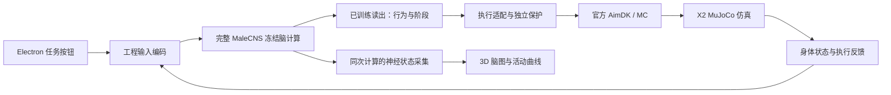

# MaleCNS

基于 MaleCNS 果蝇连接组的神经计算、机器人仿真与三维活动展示项目。Python 包和命令行名称为 `malecns_lab`，当前桌面主线是 **MaleCNS + 智元 X2 官方仿真**。

完整参考图包含 **166,700 个神经元、25,582,938 条非零有向连接**。当前桌面候选使用冻结脑计算特征，再由训练过的读出选择行为；官方 MC 负责平衡、步态和预设动作，执行层负责目标、反馈与保护。真实连接组约束不等于完整生物还原，模拟神经活动也不是活体测量。

## 快速打开

在**已经配好环境、资产和前端构建的本机**，从项目根目录运行：

```bash
npm --prefix apps/desktop start
```

点击顶部“开始”，等待脑模型、仿真和画面自动准备完成，再选择“前进、左转、右转、挥手”。不需要手动 Pause / Reset / Run。顶部“停止”结束实验并清理本次资源；“结束互动”是提交给脑模型的任务，两者含义不同。

只看脑结构和已有神经活动片段，不启动机器人或新的脑计算：

```bash
npm --prefix apps/desktop run brain
```

操作、资产要求和排障见 [桌面使用说明](apps/desktop/README.md)。**仅克隆源码不能直接运行演示**：连接组、候选模型、展示资产、官方机器人软件和私有 GPU 环境都不随 Git 分发。

## 当前系统如何工作



- **桌面工作台**：左侧官方仿真画面，右侧真实坐标脑图、逐细胞状态高亮和群组活动曲线。
- **活动采集**：支持全 166,700 细胞的窗口平均膜电位、相对请求初态的电位变化和放电率；显示平滑不增加新的神经测量。
- **空间展示**：674,411 个真实来源采样点覆盖全部细胞；21,952 条抽样连接以直线表达连接关系，不能解释为真实轴突路径或全部连接几何。
- **独立研究工具**：网页刺激响应、离线诊断、冻结读出与内部参数训练、历史 Tello 实验保留为独立入口。

代码、数据契约与边界见 [架构](docs/architecture/overview.md)、[神经计算](docs/architecture/neural-model.md)和 [数据与模型](docs/architecture/data-model.md)。

## 验证到了哪一步

| 项目 | 已有证据与限制 |
| --- | --- |
| X2 前进、左右转、挥手 | 有实际脑控仿真记录；不同候选和连续组合也有失败，不能概括成全部可靠 |
| 转向精度 | 显式 v11 / noslip1 候选有满足 ±5° 的短序列；不是当前桌面默认配置，也未通过全部 16 对动作组合 |
| 连续交互 | 收尾时可预选下一动作；UI 派发已验证，最新实际接续尝试仍有请求超时，未取得长时稳定验收 |
| 脑活动与画面 | 有同一脑实例的全细胞采集和真实渲染证据；静息显示 0 是界面基线，不代表持续测量到全脑静默 |
| 环境理解、自主探索 | 当前没有自主避障或自主探索的验收证据；按钮任务含人工行为语义 |
| 科学比较 | 当前 B 候选的旧复合任务开发门槛仍未通过；没有证据证明其优于普通小模型 |
| 真机 X2 | 尚无实机接入与动作验收记录 |

完整成功、失败和限制统一见 [项目历史](history.md#x2-continuity-20261026)；当前状态摘要见 [交接](.ai/prompts/task-handoff.md)。历史运行的配置和成绩不能直接视为当前默认版本的成绩。

## 项目目录

```text
apps/
  desktop/              Electron 工作台、3D 脑渲染、资产打包与桌面测试
  atlas/                独立网页神经图谱与刺激实验界面
src/malecns_lab/
  brain/                连接组、神经动力学与数值核心
  senses/               视觉与任务/身体状态编码
  learning/             特征、读出、训练、缓存与神经遥测
  control/              行为契约、运动适配与保护
  runtime/x2/           桌面会话、GPU 资源与进程生命周期
  experiments/          X2 容器协议和历史 Tello 实验入口
  diagnostics/          离线重放、报告与对照诊断
  visualization/        图谱导出、刺激任务服务
  drones/               历史简化控制环境
deploy/x2/             私有 GPU 仿真部署配置
configs/               配置示例
examples/              数值与性能基准脚本
tests/                 Python 检查；X2 专项在 tests/x2/
docs/
  guides/               使用指南
  architecture/         架构、数据契约、神经模型
  research/             训练、离线实验与研究边界
constitution/          项目使命
.ai/prompts/           当前交接
history.md             历史结果、失败证据与路线变化
data/、logs/           本地科研与运行资产，不入库
```

`data/`、`logs/`、模型、原始录像、旧 run 的 `sources`、虚拟环境和本机 GPU 安装都不是可随意清除的缓存。`apps/desktop/dist/` 虽然是构建产物，但现成桌面启动依赖它。

## 开发环境

Python 要求 ≥3.11。基础离线开发环境可按需创建：

```bash
python3 -m venv .venv
.venv/bin/python -m pip install -e '.[dev]'
.venv/bin/python -m malecns_lab --help
```

这只准备基础 Python 工具，不等于 X2 脑控环境就绪。桌面后端固定使用项目 `.venv-train/bin/python`；计算与训练依赖以 [pyproject.toml](pyproject.toml)及 [训练说明](docs/research/training.md)为准。

前端需要 Node.js ≥22.12。已有匹配本地资产时，在 `apps/desktop` 执行 `npm ci`、`npm run build`；构建会校验并复制资产，缺失时明确报错，不自动下载模型或补造数据。私有 GPU 安装维护见 [部署说明](deploy/x2/README.md)，新机器从头部署尚未完成整体验收。

检查按改动范围选择，遵循 [AGENTS.md](AGENTS.md)；文档或样式微调不默认运行完整测试、构建或训练。

## 文档入口

| 想了解什么 | 入口 |
| --- | --- |
| 打开应用、控制按钮、脑图含义、启动问题 | [桌面使用说明](apps/desktop/README.md) |
| 独立网页图谱与刺激响应 | [神经活动图谱](docs/guides/neural-atlas.md) |
| 模块与接口、计算和设备的边界 | [架构](docs/architecture/overview.md) |
| 原始数据、完整参考图和时间契约 | [数据与模型](docs/architecture/data-model.md) |
| LIF 方程、输入映射和可训练参数 | [神经模型](docs/architecture/neural-model.md) |
| 训练、checkpoint 与恢复 | [训练与存档](docs/research/training.md) |
| 录像诊断、读出和拓扑对照 | [离线研究](docs/research/offline.md) |
| 能提出哪些科学主张 | [研究边界](docs/research/boundaries.md) |
| 历史 Tello 工具 | [Tello 指南](docs/guides/tello.md) |
| 具体场次、失败记录、历史版本 | [项目历史](history.md) |
| 使命与当前交接 | [使命](constitution/mission.md) · [交接](.ai/prompts/task-handoff.md) |

## 来源与许可

项目基于 [SpikeCalls/FlyDrones](https://github.com/SpikeCalls/FlyDrones) 发展，保留 [MIT 许可](LICENSE)及上游版权。MaleCNS 数据和官方机器人软件分别适用各自许可，见 [THIRD_PARTY.md](THIRD_PARTY.md)。
