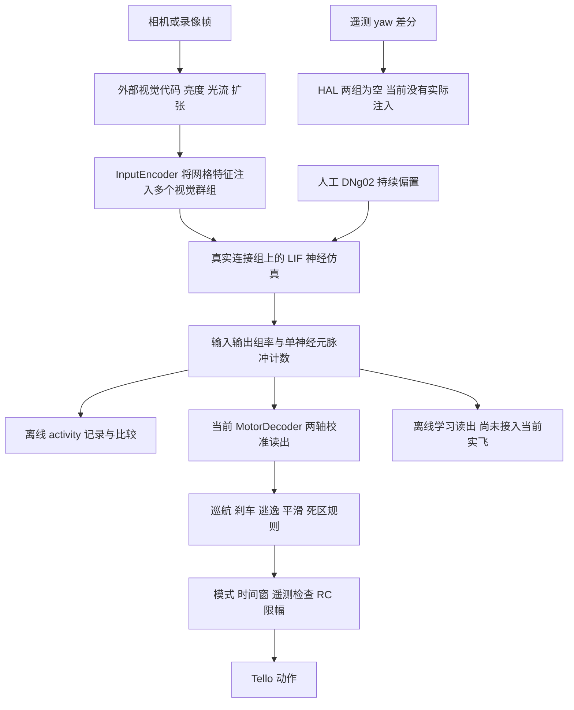

# MaleCNS 数据过滤与输入输出审计报告

> 历史审计：源码定位使用审计时的 `src/cnsbridge/` 名称与行号，不是当前 checkout 的链接；本文不作为当前操作入口。完整参考及当前结论见 [研究说明](RESEARCH.md)与[实验记录](EXPERIMENT_RESULTS.md)。

审计日期：2026 年 10 月 16 日。源码基线：`747a8aa38031ed927d121afbb85aaf9643256612`。对象为本地 MaleCNS v1.0 原始表、`data/malecns_brain.npz`、当前配置和 `readout_malecns.json`。

**现有模型确实使用真实连接组，且与当前构建规则一致。主要发现是输入映射存在明确遗漏，动作输出也只有部分通道由校准后的神经率决定。** 再下载文件或用相同参数重建，均不会自动改变这些行为。

## 主要发现

| 发现 | 实际影响 |
|---|---|
| 图中有 3,377 个 R1–R6，亮度输入只匹配 13 个 | 当前侧别取 somaSide；其余 3,364 个没有 somaSide，但有 rootSide。它们仍在图中，只未被选为亮度输入 |
| HAL_L 和 HAL_R 均为零，但原始数据中有 205 个 haltere 标注，全部已在图中 | haltere 位于 subclass，配置却只匹配 type；这 205 个 somaSide 又全部为空，因此同时存在字段和侧别两层映射障碍 |
| 相同节点集合下，最低突触数从 1 提到 3，删除 58.88% 有向连接、15.97% 突触计数 | 弱连接过滤幅度很大；这些比例不等于功能损失比例 |
| 当前线性动作读出只有 throttle 和 yaw | cruise/full 的前进来自固定巡航量加神经刹车，侧移读出为零 |
| 方向和逼近特征在网络外算好，再注入多个视觉处理层级 | 当前模型没有从原始像素开始独立完成全部视觉计算 |
| 现存读出文件的来源无法绑定到当前图和配置 | 加载其 baseline 后不会重新估计现场基线，保存的 R² 也不能当作真实视频准确率 |

本报告给出数据计数与代码行为，不将结构可达性解释为实际放电效果，也不将本地过滤比例解释为生物学重建完成率。

## 数据来源与模型一致性

下载目录包含官方 `flat-connectome` 发布目录全部 11 个文件，共 31,318,683,398 字节。官方将完整 weights 定义为有突触片段之间的连接图，端点并非都已归属到完整神经元；当前表名中的 `minconf-0.5` 已包含官方置信度筛选。[官方下载说明](https://male-cns.janelia.org/download/)

实际构建器只读取三份文件：`body-annotations`、`body-neurotransmitters`、完整 `connectome-weights`。其他八份统计、逐突触数据和官方派生子集尚未被构建器使用。运行时直接加载 NPZ，也不会因为下载目录增加文件而自动更新网络。构建器（历史源码 `src/cnsbridge/brain/connectome.py#L204`）、模型加载（历史源码 `src/cnsbridge/brain/brain.py#L16`）

逐项对照这三张源表与当前 NPZ 的结果：

- 节点：166,700；节点顺序、body ID、类型、superclass、保存后的侧别完全一致。
- 有向连接：10,520,377；每一个保留端点对及带符号权重都一致，无多余、缺少或重复端点对。
- 精确突触计数：104,351,893；以 int64 累加绝对权重得到。
- 模型 SHA256：`083652c348f656aa5a6f6ceb279421a046b7ec156f5d2c9c56024d069a5b53ea`。

因此，现存 NPZ 没有相对于当前构建规则遗漏数据；问题在于这些规则和输入输出映射是否符合研究目的。当前文件也没有额外应用 `sensorimotor_core` 裁剪：完整节点与连接逐项比对已经一致。

来源版本、对象 generation、大小及既有下载校验见[下载清单](../data/malecns_v1/download_manifest.json)；本次详细核对见[数据统计 JSON](../data/audits/malecns_20261016/data_filter_results.json)。

## 数据过滤情况

### 节点筛选

原始注释有 211,577 行，body ID 全部非空且唯一。构建器要求 superclass 非空，移除 44,877 行，剩余 166,700 行；随后排除 `status=Glia` 没有再移除节点，因为这些记录已经在前一步被排除。状态条件实际读取 `status`，没有要求全部为 `Traced`。节点筛选代码（历史源码 `src/cnsbridge/brain/connectome.py#L251`）

| status | 原始注释数 | 模型保留数 |
|---|---:|---:|
| Traced | 165,122 | 164,606 |
| Orphan | 15,925 | 32 |
| Glia | 11,864 | 0 |
| Unimportant | 10,751 | 0 |
| 空值 | 5,472 | 2,002 |
| Assign | 1,832 | 0 |
| Anchor | 611 | 60 |
| 合计 | 211,577 | 166,700 |

这意味着 516 个 `Traced` 记录因 superclass 缺失被排除，而保留集合中有 2,094 个非 `Traced` 状态。不能把当前筛选描述成“只保留所有严格校对完成的神经元”。模型中还有 2,194 个节点没有 type、18,003 个没有 somaSide；它们可以参加网络传播，但可能无法进入按类型或左右侧选择的群组。

### 连接筛选

下表按代码顺序统计。一个有向端点对对应一行连接，`weight` 是该连接包含的突触计数；两列不能互换。连接筛选代码（历史源码 `src/cnsbridge/brain/connectome.py#L287`）

| 依次应用的条件 | 有向连接行数 | 突触计数总和 |
|---|---:|---:|
| 官方完整 weights 表，已带 minconf 0.5 | 151,856,684 | 311,833,243 |
| weight ≥ 3 | 23,014,406 | 148,334,606 |
| 两端都在所选 166,700 节点内 | 10,520,431 | 104,352,304 |
| 再去除自连接 | 10,520,377 | 104,351,893 |

三个步骤分别移除 128,842,278、12,493,975、54 条连接，所含突触计数分别为 163,498,637、43,982,302、411。端点与自连接条件在代码中合并判断，此处拆开记账。

为单独衡量阈值影响，固定同一批 166,700 个节点，并统一排除自连接：

| 最低突触数 | 有向连接数 | 突触计数总和 |
|---|---:|---:|
| 1 | 25,582,837 | 124,177,143 |
| 2 | 15,283,167 | 113,877,473 |
| 3，当前配置 | 10,520,377 | 104,351,893 |
| 5 | 6,242,085 | 89,859,938 |
| 10 | 2,753,962 | 67,289,787 |

阈值 1 → 3 删除 15,062,460 条连接和 19,825,250 个突触计数。保留约 84.03% 的突触计数，并不能证明功能基本不变；弱连接对信号传播的影响需要后续对照实验。

当前模型突触总和占官方完整表的 33.464%，但该分母包括未进入所选节点集合的片段，**不是“模型还原了 33.464% 的果蝇大脑”**。本次未估算官方阈值之前的低置信度数据，也未重新评估显微重建完整度。

当前图有 503 个完全孤立节点；3,071 个无出边、2,190 个无入边，后两项都包含这 503 个。这里的“无连接”仅指当前筛选后的图。

### 递质与连接符号

构建器将每个突触前节点的 `consensus_nt` 转成统一的正负号，再乘突触数量。它没有使用逐突触递质概率或额外递质置信度筛选。符号规则（历史源码 `src/cnsbridge/brain/connectome.py#L19`）、符号应用（历史源码 `src/cnsbridge/brain/connectome.py#L272`）

| 递质标签 | 保留节点数 | 当前数值处理 |
|---|---:|---|
| acetylcholine | 103,720 | +1 |
| gaba | 22,069 | −1 |
| glutamate | 29,302 | −1 |
| histamine | 7,891 | −1 |
| dopamine、octopamine、serotonin | 392、101、48 | 均为 +1，没有额外“弱兴奋”缩放 |
| unclear | 2,999 | 默认 +1 |
| 递质表没有该 body | 178 | 默认 +1 |

默认正号共涉及 3,177 个节点。其中 unclear 节点影响 174,745 条保留连接、1,527,368 个突触计数；178 个无递质记录节点没有保留出边。未知递质默认兴奋是一项实际影响网络的建模选择，不能当成原始数据已经确定的生物学事实。

另有一处低影响展示差异：`Connectome.n_synapses` 使用 float32 累加，显示 104,351,896，比精确整数总和多 3。本报告使用精确计数，该差异没有改变连接矩阵。计数属性（历史源码 `src/cnsbridge/brain/connectome.py#L77`）

## 群组覆盖与缺失原因

实际配置由默认文件与 `configs/malecns.yaml` 合并。群组按 type 正则与侧别选择，Brain 启动时重新解析；全部 22 个群组与 NPZ 中保存的群组一致，没有未定义的读出或偏置群组引用。默认群组配置（历史源码 `src/cnsbridge/defaults.yaml#L34`）、解析逻辑（历史源码 `src/cnsbridge/brain/brain.py#L38`）

下表每行代表左右两个群组；左右条件分别为保存的 side 等于 L、R。T4a–d 群组名实际同时包含对应的 T4 和 T5。

| 群组前缀 | type 匹配规则 | 左侧数量 | 右侧数量 | 实际用途 |
|---|---|---:|---:|---|
| R16 | `^R1-R6$` | 4 | 9 | 亮度输入，最高 40 Hz |
| T4a | `^T4a$`、`^T5a$` | 1,661 | 1,687 | ftb 运动输入，最高 120 Hz |
| T4b | `^T4b$`、`^T5b$` | 1,707 | 1,698 | btf 运动输入，最高 120 Hz |
| T4c | `^T4c$`、`^T5c$` | 1,757 | 1,741 | 画面上移输入，最高 120 Hz |
| T4d | `^T4d$`、`^T5d$` | 1,662 | 1,667 | 画面下移输入，最高 120 Hz |
| LPLC2 | `^LPLC2$` | 94 | 91 | 画面扩张输入，最高 200 Hz |
| LC4 | `^LC4$` | 71 | 55 | 扩张变化输入，最高 150 Hz |
| HAL | `(?i)haltere` | 0 | 0 | 计划接收偏航反馈，当前未注入任何节点 |
| DNg02 | `^DNg02` | 15 | 14 | 输出读出，并各加 8 mV 人工持续偏置 |
| DNp03 | `^DNp03$` | 1 | 1 | 输出读出及刹车 |
| DNp01 | `^DNp01$`、`^GF$` | 1 | 1 | 输出读出、刹车与逃逸规则；实际均为 DNp01 |

实际输入节点并集为 13,904，输出节点并集为 33，两者没有重叠。上述正则在原始注释中匹配的节点均没有被节点筛选丢弃；发现的遗漏主要发生在群组选择层。[完整群组证据](../data/audits/malecns_20261016/group_audit.json)

### R1–R6 侧别遗漏

图中 3,377 个 R1–R6 全部有 rootSide：L 1,112、R 2,265。但 somaSide 只有 L 4、R 9，其余 3,364 个缺失。构建器在整张表上优先选择 somaSide 列，没有按行或按细胞类别回退到 rootSide，群组因此只覆盖 13 / 3,377，即约 0.385%。侧别列选择（历史源码 `src/cnsbridge/brain/connectome.py#L254`）

这 3,364 个节点仍然在网络里。侧别保存为字符串 `nan` 与本机当前构建和序列化行为一致，不是模型版本漂移。直接运动输入同时进入 T4/T5、LPLC2、LC4，所以不能据此说网络完全没有视觉驱动。

rootSide 提供了可核查的替代注释，但侧别字段应按细胞类别解释；不能把全图的 somaSide 一律替换成 rootSide。

### HAL 是映射缺失

原始 `subclass=haltere` 的 205 条记录全部已在当前图中，status 全为 Traced，entryNerve 全为 DMetaN。它们的 rootSide 为 L 104、R 101，somaSide 全部缺失。

当前接口存在两道障碍：

1. `GroupSpec` 只在 type 中查 `haltere`，不会查 subclass；实际 type 是 SApp、SNpp 等名称，还有 4 条没有 type。
2. 即使找到这些节点，当前保存侧别也无法匹配 L/R。NPZ 没有保留原始 subclass 和 rootSide 供群组直接使用。

简单替换成 type 名称列表也不能准确选中这批细胞：相同非空 type 在原始表中匹配 219 条，其中 18 条不是 haltere，同时会漏掉 4 条无 type 的 haltere。后续应保留或关联官方注释字段，按 subclass 和适用侧别建立明确选择规则，再验证设备偏航反馈的编码假设。群组选择接口（历史源码 `src/cnsbridge/brain/connectome.py#L41`）、[HAL 注释证据](../data/audits/malecns_20261016/group_audit.json)

### 结构通路存在，但不等于功能已验证

对当前有向图作多源广度搜索，保留正、负连接但忽略其符号：每个非空输入群组均可到达全部 33 个输出节点。对输出节点分别求最短路径后，R16 两组最迟在 5 跳内覆盖全部输出，其他视觉输入组最迟在 3 跳内覆盖全部输出。

例如，LPLC2 到同侧 DNp01 的直接正连接数为左 93、右 89；LC4 到同侧 DNp03 为左 71、右 54。这是当前图的结构事实。路径经过的抑制作用、时间动力学和输入强度仍会决定实际响应，不能用“存在路径”证明正确转向或避障。

## 输入到输出的实际通路



### 感觉编码和神经计算

当前没有物体识别网络。Retina 将画面缩为 96×72，把单个前向画面的左右半幅当作两眼，每眼 6×8 网格；软件计算 Lucas–Kanade 光流和扩张。图像上移形成 up，下移形成 down，左右眼分别定义 ftb/btf。外部代码再把这些特征同时注入 R1–R6、T4/T5、LPLC2、LC4，并非所有视觉处理都由连接组从像素中自行产生。Retina（历史源码 `src/cnsbridge/senses/retina.py#L96`）

InputEncoder 将组内第 k 个神经元映射到 `floor(k×48/n)` 网格，依据索引顺序，不使用真实眼柱、突触位置或受体场。只有 4 / 9 个成员的 R16 两组分别只能采样 4 / 9 个网格位置。外部输入率控制随机触发概率，不等于神经元的实际放电率。编码器（历史源码 `src/cnsbridge/senses/encoder.py#L25`）、外部刺激（历史源码 `src/cnsbridge/brain/lif.py#L181`）

网络按真实有向连接与软件指定的递质符号传播，使用统一 LIF 参数和 0.5 ms 步长；DNg02 另有人工 8 mV 偏置。当前脑处理每次推进 50 ms 仿真时间，输出六个群组的每神经元平均 Hz。33 个输出单元参与动作读出；配置的 600 个记录单元只是光栅抽样数量，不会把仿真图裁成 600 个节点。脑计算（历史源码 `src/cnsbridge/brain/brain.py#L54`）

光流单位是缩小图像的像素/处理帧，没有按实际帧间秒数归一化。`loom_speed` 是扩张信号的逐次变化量，也不是标定后的接近速度。另有一处编码差异：当前帧为 BGR，但灰度权重按 RGB 顺序使用，红蓝通道贡献会交换。本次仅记录。灰度处理（历史源码 `src/cnsbridge/senses/retina.py#L44`）

### 现存动作读出

`readout_malecns.json` 覆盖 throttle、yaw 的默认公式。下表为当前实际权重；轴 gain 均为 1，线性部分是 `Σ 权重 × (实际组率 − baseline)`。

| 输出组 | baseline Hz | throttle 权重 | yaw 权重 |
|---|---:|---:|---:|
| DNg02_L | 15.722 | 0.02852 | 0.00911 |
| DNg02_R | 4.911 | 0.00702 | −0.00611 |
| DNp03_L | 0 | 0.00014 | 0.00179 |
| DNp03_R | 0 | 0，未写入 | 0，未写入 |
| DNp01_L | 0 | 0.00007 | 0.00090 |
| DNp01_R | 0 | 0.00028 | −0.00187 |

DNp03_R 有神经元且被观测，只是没有参与这两轴的线性读出；它仍参与刹车。该情况不能称为“缺失神经元”。[现存读出](../readout_malecns.json)、加载与计算（历史源码 `src/cnsbridge/control/legacy.py#L48`）

| 动作轴 | 当前来源与后处理 |
|---|---|
| throttle | 上表线性读出；逃逸规则触发时可改为固定 +0.8，再经监督和 RC 限幅 |
| yaw | 上表线性读出，再经裁剪、EMA、死区和 RC 限幅 |
| forward | 神经线性读出为空；cruise/full 使用固定 cruise=0.25，乘以由 DNp03/DNp01 增量率计算的刹车因子 |
| lateral | gain=0、terms 为空，当前没有有效侧移驱动；full 放行该轴也不会自动产生非零动作 |

线性轴经 ±1 裁剪、0.2 EMA 与 0.04 死区。逃逸来自 DNp01 率的平滑阈值，触发后固定持续 0.7 仿真秒，并将前进归零。这些动作含义和规则是工程设计。动作与逃逸代码（历史源码 `src/cnsbridge/control/legacy.py#L70`）

### 校准与时间口径

当前校准代码直接构造七类全视野均匀特征，跳过像素与 Retina，给每类指定 throttle/yaw 目标，只拟合读出。它不是让连接组自行学习动作语义。现存文件记录 throttle R²=0.892、yaw R²=0.492；按当前校准实现，该指标在拟合数据自身计算，没有独立留出，不能解释为真实视频或实飞准确率。校准实现（历史源码 `src/cnsbridge/control/calibration.py#L27`）

现存 JSON 没有模型哈希、配置哈希、校准时间和原始响应矩阵，无法证明它对应当前图和配置。加载其 baseline 后，MotorDecoder 会把 `settle_s` 设为 0；配置中的 2 秒不会重新测量现场基线。试飞前 warmup 检查输出是否安静，不等于重新校准。

此外，入口的有效参数并不完全相同：

| 入口 | flow_gain / loom_gain | 固定巡航项 |
|---|---|---:|
| shadow、离线 activity 默认 | 1.2 / 8.0 | shadow 为 0；activity 不运行动作读出 |
| trial yaw、reflex、forward-check | 2.0 / 6.0 | 0 |
| trial cruise | 2.0 / 6.0 | 0.25 |
| trial full | 1.2 / 8.0 | 0.25 |

因此 cruise 与 full 不仅动作权限不同，视觉输入增益也不同。配置覆盖逻辑（历史源码 `src/cnsbridge/experiments/tello/trial.py#L50`）

trial 父进程按墙钟发送 RC，计算进程每次推进固定仿真窗口，计算慢时可能重复使用同一结果。日志中的 RC 次数不等于新脑计算次数，应按 `brain_job_id` 区分。throttle 正值最终要求上升，yaw 正值要求右转；归一化命令和 RC 数值都不等于测得的米每秒速度。模式放行、时间窗、遥测中止和 RC 限幅还会进一步改变动作。计算调度（历史源码 `src/cnsbridge/experiments/tello/trial.py#L184`）、RC 映射与监督（历史源码 `src/cnsbridge/experiments/tello/policy.py#L48`）

SafetyGovernor 的所有机制也不能仅凭配置认定已生效：ShadowBrain 传 `flying=False`，无位置且不传非零 brain_age；trial 另有独立的遥测、图像、结果时限和高度/航向边界。完整代码条件见[通路审计笔记](../data/audits/malecns_20261016/pathway_notes.md)。

## 对此前现象的解释边界

“物体上移时 throttle 增加”有明确的编码背景：校准把整幅场景向上运动当作自身下沉的信号，标注正 throttle 来补偿。但固定无人机前只上移手机并不表示飞机下沉，当前代码没有区分物体运动与相机自运动。因此不能据此认定模型理解了手机，也不能直接据此判断神经通路错误。

轻微 yaw 可能受到局部刺激与全视野校准不一致、索引式空间映射、读出权重、50 ms 群组平均、平滑、死区和 RC 限幅的共同影响。现有视觉群组到输出在图上都有路径；本次没有刺激响应或因果消融，不能确定其中哪项主导了此前实飞表现。

## 离线观察与通用解码器现状

审计时的 activity 直接记录输入驱动、实际组率和抽样神经元计数，不创建动作读出，也不产生设备动作。历史源码：`747a8aa:src/cnsbridge/diagnostics/collector.py:72`。该 V1 入口已在后续清理中移除；本段保留审计时事实，现行刺激响应观察入口见 [V2 完整脑诊断](MODEL_V2_USAGE.md)。

新的学习路径默认读取所选输出群组的全部 33 个单神经元，也可使用组平均；不是默认读取全脑 166,700 维。RidgeMotionDecoder 输出六维 BodyVelocity，但现有标签解析仅填 vx/wz，其余四轴为零。数值设备适配器已经存在，该学习读出尚未接入当前 Tello 实飞入口。历史源码：`747a8aa:src/cnsbridge/learning/prepare.py:90`、`747a8aa:src/cnsbridge/learning/decoder.py:73`。这两个 V1 模块已在后续清理中移除；本段保留审计时事实，当前对照入口见 [V2 学习工具](LEARNING_V2.md)

## 后续工作的优先顺序

1. **修正输入选择的依据。** 为 R1–R6 和 haltere 保留并使用适当的原始注释字段，明确每类侧别定义，逐组报告选中的 body ID；不要用粗略 type 列表替代 subclass。
2. **建立可追踪的实验配置。** 明确多级视觉注入和空间映射假设，统一比较入口的视觉参数；为读出绑定图、配置和校准数据身份，决定基线是否应现场重估。
3. **再比较连接阈值。** 在相同节点、输入、随机种子和刺激下比较阈值 1 与 3，记录实际放电和输出差异，再决定是否采用更多弱连接。
4. **据响应证据决定解码器特征和动作目标。** 明确需要哪些输出单元和可学习轴，再推进训练。现有固定巡航、逃逸和旧实飞结果不替代新读出的验证。

本次只交付审计，以上修正尚未实施。

## 证据与复现

| 材料 | 内容 |
|---|---|
| [数据统计](../data/audits/malecns_20261016/data_filter_results.json) | 节点与连接过滤、递质、逐项模型比对、版本与文件哈希 |
| [群组统计](../data/audits/malecns_20261016/group_audit.json) | 全部群组成员、原始字段、HAL 候选、图可达性 |
| [通路配置快照](../data/audits/malecns_20261016/pathway_metadata.json) | 合并配置、实际读出参数和源文件哈希 |
| [数据笔记](../data/audits/malecns_20261016/data_filter_notes.md)、[群组笔记](../data/audits/malecns_20261016/group_notes.txt)、[通路笔记](../data/audits/malecns_20261016/pathway_notes.md) | 统计口径、源码行号与细节 |

本地证据按项目约定放在被 Git 忽略的 data 目录，不会随源码提交。复现时从项目根目录运行以下审计脚本；它们只读取原始数据和模型，写入审计结果：

```bash
.venv/bin/python data/audits/malecns_20261016/data_filter_audit.py
.venv/bin/python data/audits/malecns_20261016/group_audit.py
```

本次全量 weights 流式查询约 9.9 秒、峰值内存约 955 MB；完成计数守恒、全部保留连接和标签比对、群组解析及结构可达性检查。审计中修正了分析脚本的 NaN 序列化比较和分类字符串列检索，分别仅重查受影响部分，没有重复扫描已经完成的连接表。文档改动按 S0 审查，未运行测试、build、lint、typecheck、神经动力学或硬件实验。原始文件、现有模型、配置和读出保持不变。
