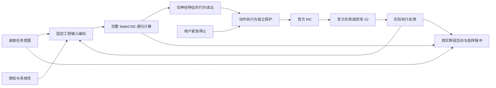

# Spec024 — X2 脑控主线整体设计

状态：Ready，2026-10-23。[独立设计验收D1–D6 PASS](acceptance.md)，整体设计已交付；主线产品P1–P6尚未实现。用户在纠正“不要把目标前进/停止的小闭环当主线”后，授权开始控制层级、首批行为、训练路线及仿真到实机验收的整体设计。

实施更新：用户随后明确要求“把你刚才说的roadmap主线都跑了”，当前目标已扩展为实施和运行M1–M6。用户确认暂时没有真机，之后上海接入；M6保留为待现场验证的完整目标。本地实施、有限训练与GPU仿真实验在本次授权内，按资源与阶段门槛执行，见[进度与证据](progress.md)。下文“本轮设计”描述已完成D0，不限制最新实施授权，也不把实机目标删减为本地完成。

## 产品目标与交付边界

完整 MaleCNS 参与机器人行为选择、持续与切换；用户能够通过桌面应用发起互动，看到同一次脑计算的真实模拟神经活动和 X2 的实际执行反馈，最终在现场实机演示。官方 Sim + MC + AimDK 为唯一机器人主线，Electron 保持已认可的左仿真、右脑模型布局。

第一版展示“打招呼、向左/右致意、向前展示、结束互动”。它们包含多次行为选择和完成反馈，不能由桌面按钮直接调用 MC，也不能由外层脚本替脑编排整段行为。结构化按钮先提供任务意图；语音以后只增加相同意图的输入方式，不预设模型具备自然语言理解。

当前设计产物包括：本 Spec、[实施路线](plan.md)、[方向决定](../../.ai/decisions/022-x2-brain-control-mainline.md)与独立设计验收。设计通过不等于行为能力、仿真、实机或展会交付通过。本轮不改变旧模型、启动训练/仿真/硬件或自动提交。

## 已有证据与缺口

| 部分 | 已有事实 | 主线缺口 |
|---|---|---|
| 完整脑 | 166700节点、25582938非零边；MPS LIF，保留延迟及递归状态 | 多模态工程输入与多行为策略 |
| 旧策略 | 红标BGR→12×16占用→3377个R1–R6→全部1314个DN的2628维特征→vx/vz/wz | 无任务意图、身体反馈、行为类别和行为阶段输入输出 |
| 旧训练 | 11752个类型共享theta及线性读出；历史四条正弦场景离线模仿 | 不是X2多行为训练，不具有指令理解证据 |
| X2适配 | 原vx>0.03二值映射；前进与水平停稳已有仿真实测 | 转向、挥手及各自完成/取消契约 |
| 桌面 | 同次控制脑真实遥测、两轮纵向动作、离线脑活动回放 | 多任务交互、行为进度与因果事件关联；缺仿真视频归档 |
| 能力评估 | Spec023中15帧全FORWARD，STOP 0/9 | 仅为旧模型限制证据，不是主线训练目标或准入前置 |

源码依据：[`gpu_policy.py`](../../src/malecns_lab/learning/gpu_policy.py)、[`policy_groups.py`](../../src/malecns_lab/brain/policy_groups.py)、[`x2_protocol.py`](../../src/malecns_lab/control/x2_protocol.py)、[`types.ts`](../../apps/desktop/src/types.ts)。实际证据：[Spec022](../spec-022-electron-workbench/actual-integration.md)、[Spec023](../spec-023-x2-task-evaluation/actual-evaluation.md)、[历史GPU训练](../spec-008-trainable-snn/gpu-recovery-run-20261019.md)。

## 控制层级与不可绕过的链路

- **任务层**：输入“希望做什么”，携带request_id；不生成预设动作ID、速度或行为序列。第一版为封闭任务集合，无LLM动作代理。
- **脑层**：决定做哪种行为、开始/继续/结束，以及允许行为的强度参数；保留一次互动内的神经和编码状态。只在新会话、显式重置或无法恢复的失败后清零，重置事件落盘。
- **读出层**：所有头只读取同一次完整脑的DN特征。任务token、视觉、MC反馈、教师目标均不得绕过脑直接拼入读出；没有外置动作分类网络。
- **执行层**：将合法脑输出翻译为核验过的官方技能，维护请求去重、控制权、反馈、动作互斥、限幅和停止。可以拒绝/终止动作，不能把拒绝的动作替换为另一展示动作，不能根据用户任务选择“下一步挥手”。
- **官方MC层**：平衡、步态及官方预设轨迹执行。准确表述为“脑选择和调节行为”；不声称脑生成挥手的逐关节轨迹或控制全身平衡。
- **观察层**：神经、动作和反馈关联到同一会话/决策；只做展示，不反向生成行为。

用户紧急停止、失去控制权、过期反馈等保护不等待脑计算。它们单独标注为保护干预，不计作脑正确决定停止。用户普通“结束互动”则进入脑，评价它是否完成行为并回待命；两者UI与证据不可混用。

## 首批行为及官方能力依据

本地版本：AimDK `v1.1.0-gfaf4c94`，MC/Sim `v1.0.0-20260522`，模型 `lx2501_3_t2d5`。下面的“有接口/资源”不等于运行通过。

| 行为读出 | 执行方式 | 当前证据 | 实施验收重点 |
|---|---|---|---|
| HOLD | 零速度、稳定站立；行为结束后回待命 | 已有水平停稳判据；非完全角速度归零 | 按上一行为区分平移、转向和手臂结束，不能共用旧STOPPED代替全部静止 |
| ADVANCE | 官方连续速度接口，有界前进段 | MC目标0.2曾实测，不是实际0.2m/s | 反馈位移、最大偏离、归零到停稳；继承原保护 |
| TURN_LEFT / TURN_RIGHT | 同接口angular_velocity，正左负右 | 本地官方接口/示例存在；旧适配器当前拒绝 | 先核验两方向、角度变化、角速度和角度漂移的停稳窗口 |
| WAVE_RIGHT | `SetMcPresetMotion`，motion=1002、area=2 | 官方配置、右手CSV和服务均存在，尚未调用 | 站稳→服务接受→确实开始→关节变化→完成→恢复待命；完成查询不能代替实际运动 |

资源依据：本地官方 [`animation_player.yaml`](../../data/x2_sim/packages/mc/bin/mc_param/src/robot/lx2501_3_t2d5/classic/animation_player.yaml)、[`action_setting.yaml`](../../data/x2_sim/packages/mc/bin/mc_param/src/robot/lx2501_3_t2d5/action_setting.yaml)、[`mc_sim.yaml`](../../data/x2_sim/packages/mc/bin/mc_param/src/robot/lx2501_3_t2d5/mc_sim.yaml)、随包 [`preset_motion.html`](../../data/x2_sim/packages/aimdk/docs/cn/_build/html/zh-cn/dev/Interface/control_mod/preset_motion.html)。这些本地厂商资产不入Git，实施时绑定包版本及文件hash。

预设动作与连续速度使用不同的控制方式：预设动作不具有连续控制的输入源优先级，不能用GetCurrentInputSource证明挥手归属。首版不抢占已有预设动作，使用interrupt=false、单请求在途、执行前空闲检查及motion/area匹配。外部并发动作或查询歧义必须报未知/失败，不能归为本次成功。取消方式与关节恢复需要M2核验；未核验不得开放该技能的用户执行入口，更不能默认销毁进程就停止挥手。

首版串行动作，不同时行走/转向/挥手。任意关节轨迹、鞠躬、自动起身和语音识别列为扩展项，不妨碍保留多行为主线。若当前官方版本无法完成挥手，记录主线缺口并处理版本/接口，不能悄悄删掉挥手后把只会前进的系统标成主线完成。

## 用户互动与行为评价

| 用户任务 | 在正常初态下的目标行为 | 必须覆盖的上下文 |
|---|---|---|
| 打招呼 | 稳定站立时挥手，完成后待命 | 已在挥手时不重复启动；未站稳时等待；拒绝时不得假完成 |
| 向左致意 | 左转、确认停止、挥手、待命 | 已面向目标时可省去转向；转向未完成时不得提前挥手 |
| 向右致意 | 右转、确认停止、挥手、待命 | 对称方向与切换请求，不能一律选择同一方向 |
| 向前展示 | 有界前进、停稳、挥手、待命 | 完成/被拒绝/反馈过期分开，不能不断重复前进 |
| 结束互动 | 结束当前行为并回待命 | 空闲、移动中、挥手中分别测试；独立紧急停止另计 |

这是首版的任务定义与训练教师目标，不是运行时脚本。执行器只执行脑当前输出的一项行为。一次技能达到上限后可以自动归零/结束执行并反馈“到界/完成”，但选择下一技能仍需下一次脑输出。已成功的动作不得由相同决策重放；CONTINUE不创建新请求。

## 新策略契约与迁移

以下为新版本契约设计，不修改旧的`cnsbridge.*`或现有X2二值运行格式。

**输入 Observation**：session_id、observation_seq、request_id、单调接收时刻；结构化任务枚举与请求变化；感知值及独立valid/age/source；身体朝向/速度、MC模式、已发技能ID、实际执行阶段/完成/拒绝、能力可用性。身体坐标/单位按FLU；遥测传感器和人为交互值分别标源。仿真特权真值、教师动作、未来帧不得进入策略。当前无相机时使用明确缺失掩码，不称人物识别或实际视觉导航。

**编码**：首版使用固定、稀疏、可登记的工程编码，把任务、反馈和视觉各通道映射为有界神经刺激。V1复用已核验的全部R1–R6作为工程刺激端口，通道使用独立固定码本，禁止直接刺激DN以植入动作答案；这不是生物学语言/本体感觉的解剖对应。完整图不剪枝、不加合成替代脑。M1封存码本、body_id顺序、尺度、饱和处理、有效性编码和hash；已有GPUDrive的固定视觉假设须由新编码适配，不能仅拼接旧RGB冒称多感官模型。若后续改用其他真实感觉群组或学习编码器，另登记模型版本和参数清单。

**脑与读出**：沿用完整图MPS LIF数值内核，新增有独立身份的X2策略。首版行为头为HOLD/ADVANCE/TURN_LEFT/TURN_RIGHT/WAVE_RIGHT；阶段头为START/CONTINUE/FINISH；参数头仅对前进/转向给出归一化强度，方向由行为枚举表达，挥手使用官方固定轨迹且不假设可调幅度。DN两半窗特征沿现有2628维方式起步。参数由已登记技能包转换成MC目标并限幅，未经标定不把参数叫实测速度。

**输出 Decision**：decision_seq、request_id、observation_seq、state_before/after_id、三头原始logits/参数、已解码行为/阶段、policy/checkpoint/input_map身份和神经时间窗。决策新鲜度由主机按消费的观测时刻与固定预算判定，不能由模型续期。非法行为/阶段组合只拒绝并记录，不静默改成正确答案；HOLD本身与保护归零分别归档。

**执行 ExecutionEvent**：decision_seq与唯一execution_id、backend(sim/robot)、技能包版本、实际MC请求、接受/开始/执行/完成/取消/失败/未知、原始状态与关节/odom反馈、实际接收时间、停止证据及保护原因。服务ACK只证明请求接受，不能当成运动完成。

**来源迁移**：旧图与数值内核可复用；旧theta仅作明确迁移初始化候选，按图/类型顺序逐项校验。旧三轴读出废弃于新策略，保持原文件不动；新多头独立初始化，优化器重置，登记新policy/checkpoint/schema及迁移报告。旧冻结后端保留供历史重放，不改其54份来源快照或把新策略称为精确等价优化。

## 训练与证据路线

1. **任务数据**：按完整互动片段组织指令、可部署观测、真实/明确标记的模拟执行反馈与教师标签。覆盖同任务不同状态、相同场景不同任务、执行中重复请求、完成、拒绝、普通结束与保护触发；不能只训练静态“按钮→动作”表。教师可由登记的示范/任务规则生成，但推理时不得调用教师。
2. **数据隔离**：按整段互动、初始姿态、动作顺序和反馈时间条件划分train/validation/locked-test；不随机拆相邻帧。Spec023的15帧仅保留为历史诊断，不作为本主线训练集或通过门槛。锁定测试及评分协议在训练前封存；验证集选checkpoint，测试失败后新版本不得继续声称原测试是未见数据。
3. **先建立读出基线，再训练内部参数**：同一输入下比较固定theta+新读出与theta+读出联合训练。允许旧theta初始化和中性theta初始化做预登记对照。类别/阶段使用分类损失；参数损失仅作用于相关行为；增益沿现有受约束形式。准确率、行为完成率与保护次数分别报告。
4. **时序学习**：一次互动内保留状态，训练使用跨决策窗口而非每个动作重置。旧100步信用范围只有10ms，不能直接视为已解决跨行为学习。M3小规模有界探针测量跨窗口梯度、MPS资源与实际耗时，再冻结训练窗口/截断长度/更新次数；探针不是主线行为验收。
5. **真实反馈接入**：离线初始数据明确标记为模拟执行反馈；M2核验官方技能后采集仿真反馈，增补训练失败与时延分布。最终锁定评估必须覆盖这些真实反馈，不能只在理想状态机标签上通过。
6. **脑参与审计**：完整记录任务→编码→递归神经状态→仅神经读出→MC→反馈；配对固定输入/初态，对真实DN特征与预登记常量/时间打乱特征读出作离线对照。若行为不依赖神经特征，不得宣称功能参与通过。此结果不证明真实连接组优于其他拓扑；结构优势需要另立同数据/容量/预算对照，不是展会交付的必要主张。

M3运行登记必须冻结：数据与拆分hash、编码与模型身份、所有可训练参数、初始化、loss/权重、优化器/LR、随机种子、跨决策窗口、状态重置、最大更新数、验证频率、checkpoint选择、测试与功能对照评分、单次/总运行预算。参数变化后重新登记，不用“继续到成功”为训练停止条件。

## 桌面、时钟与资源

- 保持左右布局与简体中文。增加必要的任务操作、当前行为和执行状态；不恢复已删大标题、底部播放条或解释性小字。缺能力、正在计算、拒绝及停止未确认必须可见。
- 同一策略实例产生遥测，继续22群组均值与32选样神经元真实spike。扩展档案关联request/decision/execution，不制造未采集的全脑脉冲或预先点亮“挥手脑区”。统计关联不写成生物功能定位。
- 高层脑决策与MC发布分频。当前实测每50ms神经窗约2.37s，仿真共驻留历史约3.64s；第一版在技能边界决策，执行器完成有界技能并等待，不依赖完整脑维持50Hz命令。决策期间显示真实计算状态，保护停止独立于推理。
- 15–30秒一轮是展示体验目标，待实测收敛；不作已有能力或硬性实时承诺。归档神经时间、主机单调时间、MC/仿真时间、延迟和丢批；多设备时记录时钟偏移，不能把同时播放不同run称同步闭环。
- 默认启动桌面不加载完整脑或仿真。使用现有单完整脑锁、至少1GiB系统预留、受监督子进程、有限墙钟和不可覆盖run；训练与仿真不并行占用完整脑。暂时不用仿真就关闭，保留Noria和默认Docker context。
- 现场展示以本地运行和清晰的失败/恢复为目标。离线录像或回放只能标作回放；不得在实时失败时暗中替换成功录像。仿真视频归档是后续同步回放需求，当前脑活动回放不冒充完整视频回放。

## 从设计到产品的验收层级

本轮只验收D项；下表P项为主线产品待完成条件，不因本设计Ready而勾选。

| 门槛 | 必须有的证据 |
|---|---|
| P1 契约与无绕过路径 | 新输入/输出/执行契约，正常结束与保护分离；脑读出只依赖神经特征；旧档案兼容；定向检查通过 |
| P2 官方技能 | 首批每种技能有正确版本的原始请求、接受、实际运动、完成及取消/停止记录；尤其挥手归属与转向停稳独立验收；有资源定义不算通过 |
| P3 学习能力 | 固定checkpoint在100条锁定离线互动（五任务各20）上任务成功至少90/100，且每类至少18/20；原始行为/阶段宏F1至少0.90；普通结束20条全部达到待命，无保护代答计分；报告全部失败和干预 |
| P4 脑的功能参与 | 同输入、同初态、同读出的配对特征干预；完整模型与每个预登记退化对照都报告差异。若与常量/打乱特征无行为区别则不通过；不得用梯度或spike存在代替 |
| P5 桌面仿真系统 | 同一run的任务、真实脑活动、MC请求与物理反馈匹配；五任务各5次预登记互动，至少23/25完成且每类至少4/5；普通结束样本全部正确回待命；独立停止保护的故障案例全部按契约处理。无动作脚本替脑补齐失败 |
| P6 现场实机与展会 | 对齐现场机型/MC/SDK/动作资源/开发权限；先只读传感器与状态，再单技能和整段互动；现场冻结速度、角度、手臂空间、停止条件与场地边界，逐步放行。三种正式展示脚本各10轮，至少29/30完整成功，保护事件单列；未到现场不得写已通过 |

任务成功不是只匹配第一条动作：整段必须满足任务次序、方向、完成反馈、正常结束与无非法重复。支持“已经面向目标”等合法省略的评分条件须随数据登记固定。退化神经特征试验只离线，不在实机做“脑区破坏”效果表演。

## 本轮设计验收

- [x] D1 明确用户主线与已知能力，不以红目标小任务替代多行为互动和实机方向。
- [x] D2 控制层级、首批行为、官方接口与未验证事项有当前源码/随包资源依据。
- [x] D3 输入/脑/读出/执行/遥测契约清晰，定义无跳接、反馈入脑、保护干预与状态持续。
- [x] D4 新训练身份、旧模型迁移、任务数据隔离、时序信用及脑参与证据有明确路线。
- [x] D5 P1–P6分层验收、实施顺序、资源与现场依赖明确，设计完成不冒充产品完成。
- [x] D6 新独立设计验收通过，当前交接与入口同步；本轮停止于设计交付，无业务代码/训练/设备动作。

## 待验证依赖

挥手取消/归属、角速度停稳、MPS跨决策训练成本和现场机型版本是明确的后续阶段任务；分别由M2、M3、M6解决。它们阻止对应能力被宣称完成，不阻止先实施M1新契约。当前无需用户补充信息即可交付整体设计；展会日期、现场设备与场地限制在安排现场执行前取得。
